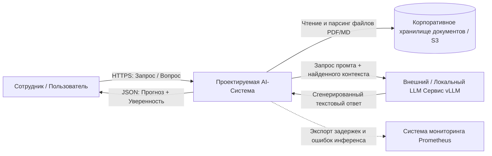
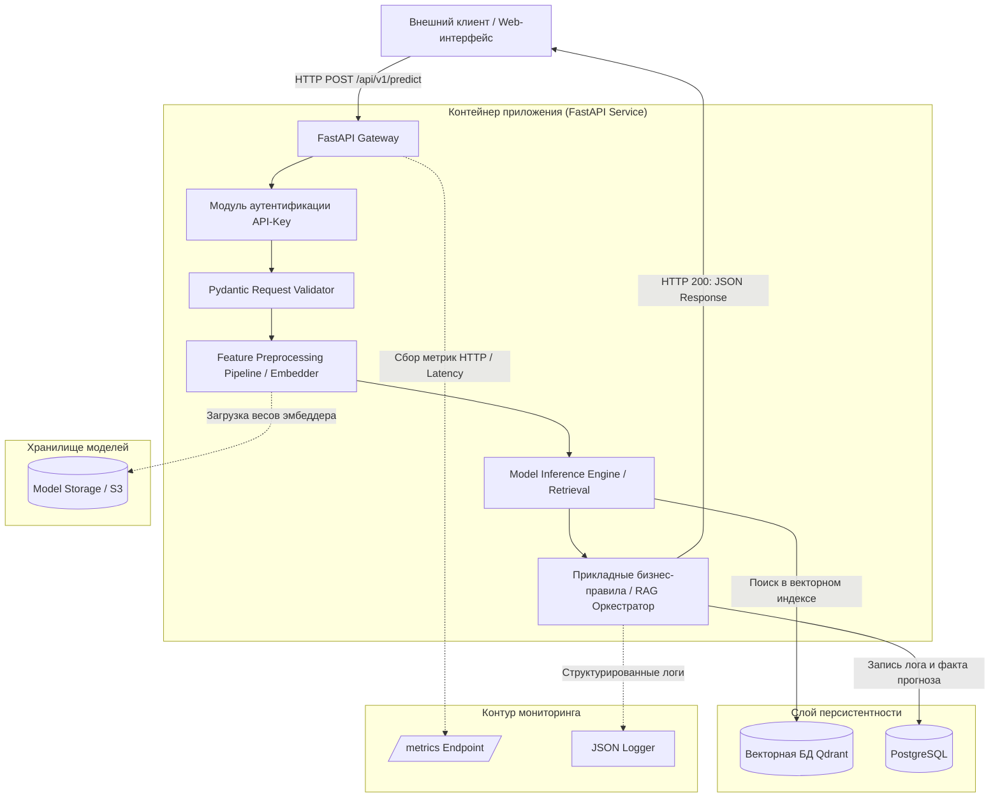

# Корпоративная вопросно-ответная система по регламентам (Enterprise RAG)

## 1. Цель и задачи проекта
* **Бизнес-проблема:** Высокие временные затраты сотрудников компании на ручной поиск информации в нормативных документах (регламенты, инструкции, PDF). Это приводит к замедлению процессов и операционным ошибкам.
* **Бизнес-цель:** Создать корпоративную систему на базе семантического поиска и генеративного ИИ (Enterprise RAG), предоставляющую мгновенные и безопасные ответы на вопросы сотрудников, строго опираясь на базу знаний с предоставлением ссылок на первоисточники.
* **Конечные потребители:** Внутренние сотрудники компании и администраторы базы знаний.
* **Класс задачи ИИ:** Семантический поиск (Information Retrieval) + Генеративный ИИ (RAG / LLM).

---

## 2. Метрики эффективности системы

### Метрики бизнес-процесса:
* Сокращение времени поиска ответа на регламентированный вопрос с 15 минут до < 30 секунд.
* Снижение количества нарушений внутренних правил сотрудниками на 25% за счет доступности актуальных выдержек.

### Технические метрики (SLA):
* Время ответа сервиса: \(p95 < 2.5\) сек (с учетом генерации текста языковой моделью).
* Пропускная способность шлюза: \(RPS \ge 10\).
* Доступность системы (Availability): \(99.5\%\).

### Метрики качества модели (ML):
* Качество поиска (Retrieval): \(Hit\ Rate@3 \ge 0.92\) (целевой документ попадает в топ-3 выдачи векторного поиска).
* Качество генерации (Generation): \(Faithfulness \ge 0.95\) (отсутствие галлюцинаций, модель отвечает строго по контексту).
* Релевантность ответа (Answer Relevance): \(\ge 0.88\).

---

## Границы системы (Scope)
* **Входит в контур:** Валидация входящих запросов, парсинг документов, чанкинг, извлечение эмбеддингов, гибридный векторный поиск (BM25 + Dense Qdrant), генерация ответа через LLM, логирование, разметка источников и сбор метрик дрейфа.
* **Не входит в контур:** Прямое редактирование текстов нормативных документов, кадровые перестановки, бухгалтерские проводки и юридическое утверждение приказов.

### Таблица архитектурных требований:

| Тип требования | Код | Формулировка требования | Критерий приемки |
| :--- | :--- | :--- | :--- |
| Функциональное | FR-01 | Прием входных данных через REST API | Эндпоинт POST `/api/v1/predict` принимает валидный JSON и возвращает предсказание. |
| Функциональное | FR-02 | Фильтрация невалидных данных | При нарушении схемы возвращается статус 400 Bad Request с указанием поля. |
| Функциональное | FR-03 | Fallback на человека | При уверенности модели (скор релевантности чанков) < 0.4 выставляется флаг `manual_review_required = true`. |
| Нефункциональное | NFR-01 | Производительность поиска | Время семантического поиска в векторной БД на CPU не превышает 150 мс. |
| Нефункциональное | NFR-02 | Воспроизводимость | Каждый ответ модели содержит метаданные: `model_version`, `db_version` и `request_id`. |
| Нефункциональное | NFR-03 | Безопасность | Доступ к эндпоинтам защищен статическим токеном в заголовке `X-API-Key`. |

---

## Контекст системы (C4 Model — Level 1: System Context)

### 1. Контекстная диаграмма Mermaid


### 2. Описание информационных потоков
* **Поток "Запрос пользователя":** Протокол HTTPS (REST API), формат полезной нагрузки — JSON (передается строка вопроса и ID сессии). Синхронный режим взаимодействия.
* **Поток "Инференс LLM":** Протокол HTTPS/gRPC. Передается структурированный промт, содержащий извлеченные из базы знаний текстовые абзацы. Возвращается сгенерированный ответ.

---

## Компонентная декомпозиция (C4 Model — Level 2: Container / Component)

### 1. Диаграмма компонентов Mermaid


### 2. Таблица компонентов системы

| Компонент | Назначение модуля | Входные данные | Выходные данные | Используемые библиотеки |
| :--- | :--- | :--- | :--- | :--- |
| `app.api.routes` | Обработка HTTP-запросов и роутинг | HTTP Request | HTTP Response | `fastapi`, `starlette` |
| `app.api.schemas` | Pydantic-схемы валидации ввода | JSON Raw Payload | Строго типизированный объект | `pydantic` |
| `app.ml.preprocessing` | Трансформация текста в эмбеддинги | Строка (вопрос) | Числовой вектор (Tensor) | `sentence-transformers`, `numpy` |
| `app.ml.inference` | Исполнение гибридного поиска | Вектор запроса | Топ-K текстовых фрагментов | `qdrant-client`, `rank-bm25` |
| `app.services.prediction`| Оркестрация бизнес-правил RAG | Набор чанков, вопрос | Финальный бизнес-результат | Чистый Python |
| `app.repositories` | Персистентность фактов инференса | Сущность лога | Запись в БД | `sqlalchemy`, `aiosqlite` |

---

## Спецификация контрактов REST API

### 1. Главный эндпоинт инференса: POST /api/v1/predict
* **Заголовки:** `Content-Type: application/json`, `X-API-Key: <secret_token>`.
* **Схема входных и выходных данных:** Реализована программно в модуле `app/api/schemas.py`.

**Пример тела успешного ответа (200 OK):**
```json
{
  "request_id": "4a7c1b5e-8d9e-4b2a-8d1c-9e2b1a4c8d3e",
  "item_id": "USER_SESSION_42",
  "prediction": "Согласно разделу 3 'Положения об отпусках', продолжительность отпуска составляет 28 календарных дней.",
  "probability": 0.89,
  "model_version": "bge-m3_llama-3",
  "manual_review_required": false,
  "sources": [
    {
      "document_name": "Положение_об_отпусках.pdf",
      "page_number": 5,
      "chunk_id": "chunk_f8c142b9"
    }
  ]
}
```

### 2. Системные эндпоинты
* `GET /health` — проверка состояния сервиса. Возвращает статус готовности шлюза и подключений к БД:
```json
{"status": "healthy", "model_loaded": true, "model_version": "bge-m3_llama-3", "uptime_seconds": 3600}
```
* `GET /metrics` — выдача метрик для Prometheus в формате OpenMetrics.

---

## Безопасность, наблюдаемость и устойчивость

### 1. Информационная безопасность и защита данных
* **Аутентификация:** Передача ключа осуществляется в заголовке `X-API-Key`.
* **Защита от DoS/DDoS:** Ограничение размера полезной нагрузки (Payload Size Limit) до 2 Мб на уровне веб-сервера. Установлены жесткие тайм-ауты на запросы к инфраструктурным узлам.
* **Соблюдение 152-ФЗ:** Перед отправкой текстового вопроса на инференс модуль бизнес-логики производит регулярное маскирование персональных данных (ФИО, телефоны), предотвращая их утечку во внешние LLM-сервисы и логи.

### 2. Наблюдаемость (Observability) и аудит
* **Формат логов:** Каждое обращение атомарно логируется в стандартный поток вывода в формате JSON:
```json
{"timestamp": "2026-10-06T12:00:00Z", "level": "INFO", "request_id": "4a7c1b5e", "item_id": "USER_SESSION_42", "latency_ms": 124.5, "status": 200, "prediction": "SUCCESS", "model_version": "bge-m3_llama-3"}
```
* **Метрики сервиса (Prometheus):** `http_requests_total` (счетчик HTTP-ответов), `http_request_duration_seconds` (задержки API-шлюза), `model_inference_duration_seconds` (чистое время инференса моделей).
* **Контроль дрейфа данных (Data Drift):** Накопленные текстовые запросы еженедельно выгружаются из базы данных для проведения offline-анализа статистического расхождения распределений векторов входящих признаков с помощью библиотеки `Evidently` (тесты Колмогорова-Смирнова).

---

## Архитектурные решения (ADR)
Основные инженерные компромиссы и обоснования технологического стека вынесены в отдельные структурированные карточки решений:
* [ADR-01: Выбор режима инференса (Synchronous REST API)](docs/adr/ADR-01-inference-mode.md)
* [ADR-02: Стратегия хранения артефактов моделей (S3 MinIO)](docs/adr/ADR-02-model-storage.md)
* [ADR-03: Архитектурный стиль сервиса (Модульный монолит)](docs/adr/ADR-03-architecture-style.md)
