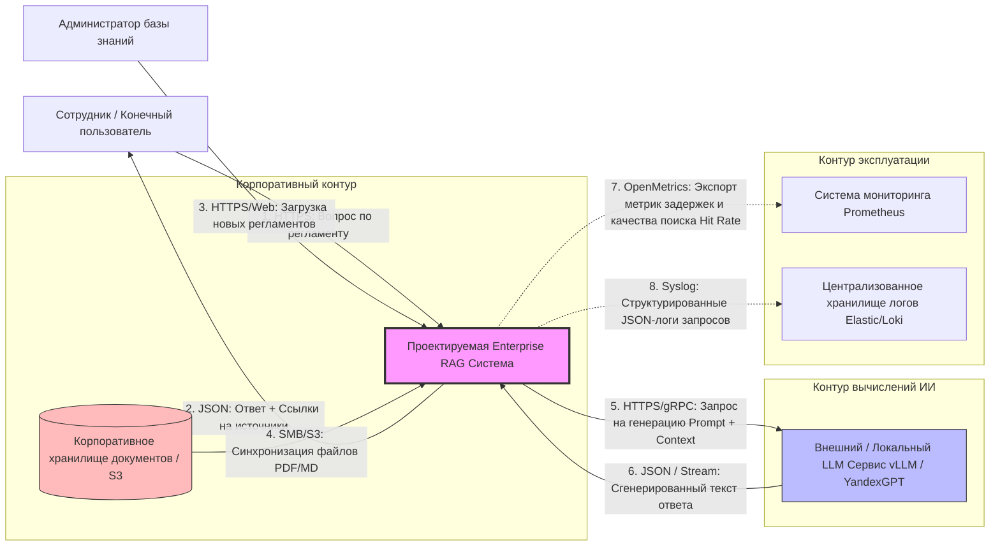
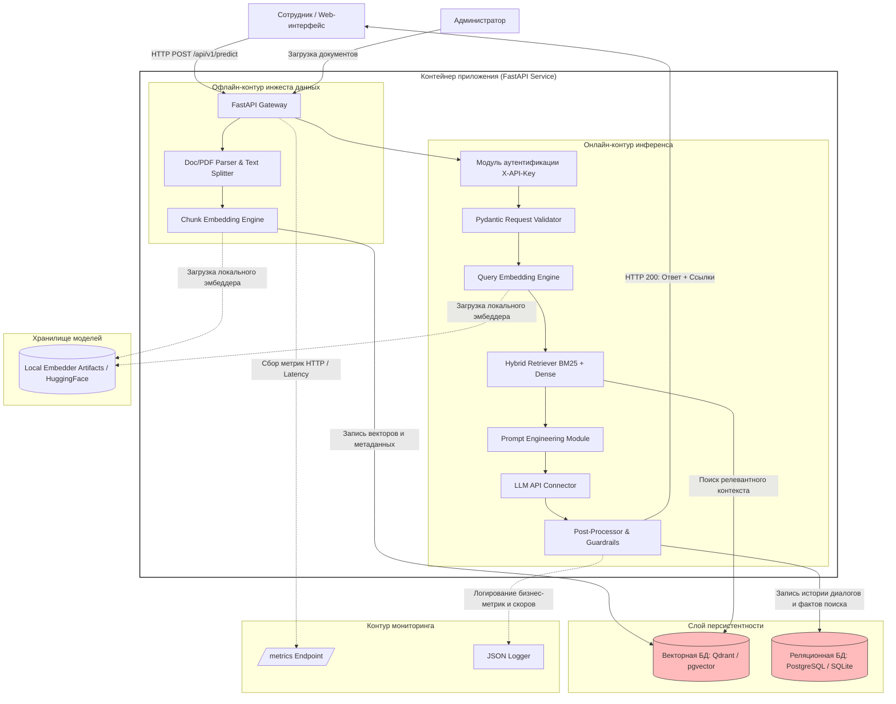

# Архитектура Enterprise-RAG: Диаграммы и компоненты

## Контекстная диаграмма (C4 Model — Level 1: System Context)

### 1. Код диаграммы для Mermaid


### 2. Описание информационных потоков
1. **User -> RAG:** HTTPS (REST API), формат JSON (текст `question` и `session_id`).
2. **RAG -> User:** HTTPS Response, формат JSON (текст `answer`, массив источников `sources`).
3. **Corp Storage -> RAG:** S3 API, асинхронный пакетный процесс загрузки бинарных PDF/MD файлов.
4. **RAG -> LLM:** HTTPS/gRPC, передача системного промта и найденного контекста документов для генерации.

---

## Компонентная декомпозиция (C4 Model — Level 2: Container / Component)

### 1. Код диаграммы компонентов для Mermaid


### 2. Спецификация компонентов системы
* `app.api.routes` — Обработка запросов и маршрутизация (fastapi).
* `app.api.schemas` — Pydantic-валидация сырых данных (pydantic).
* `app.ml.parser` — Парсинг PDF/Markdown и деление на чанки (langchain-text-splitters).
* `app.ml.embedder` — Расчет векторных представлений текста (sentence-transformers).
* `app.ml.retriever` — Поиск документов в векторной БД (qdrant-client, rank-bm25).

---

## 💻 Системные эндпоинты (Этап 5.2)

### GET /health — Проверка статуса (Health Check)
```json
{
  "status": "healthy",
  "components": {
    "api_gateway": "up",
    "vector_database": "connected",
    "llm_provider": "connected"
  },
  "model_loaded": true,
  "model_version": "bge-m3_llama-3-8b-instruct",
  "uptime_seconds": 86400
}
```

### GET /metrics — Метрики для Prometheus
Формат OpenMetrics:
```text
http_requests_total{method="POST",endpoint="/api/v1/predict",status="200"} 1420
http_request_duration_seconds_bucket{le="1.0"} 1350
rag_retrieval_confidence_score 0.89
```
